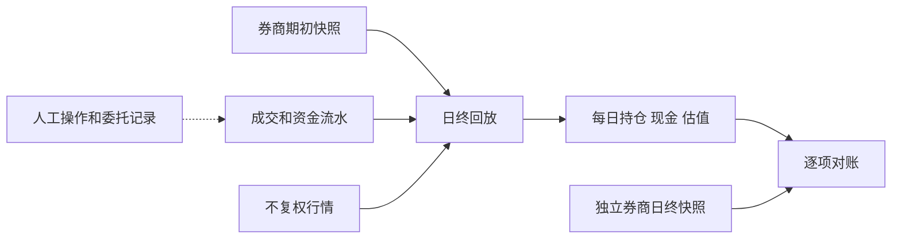

# A 股与港股账户持仓回放

> 范围：手工操作的普通现金账户，单账户单市场，按原币日终回放。第 1–6 节用 A 股人民币账户举例，第 7 节为港股港元账户。

从一份券商日终快照起步，按后续流水重建每日总持仓和人民币资金余额，再用独立的券商日终快照核对。操作记录用来解释当时为什么做出决定，委托和成交用编号关联，账户变动以券商流水为准。先接一种券商导出格式，行情只用于估值。若暂时只有区间末的持仓和现金快照，可以生成每天的回放结果，对账结论只覆盖有快照的日期。



## 1. 数据怎么存

| 区域 | 建议位置 | 内容 |
|---|---|---|
| 输入区 | `inputs/data/cache/account_replay/<account>/raw/` | 原始券商导出：期初及核对快照、成交、资金流水、可选委托。原件只读，保留导出范围、文件 SHA-256 和原始行号。 |
| 工作区 | `workspace/runs/account_replay/<account>/ledger.sqlite` | 导入批次、快照、标准化流水、人工操作和委托关联。 |
| 输出区 | `outputs/reports/account_replay/<account>/<run_id>/` | `positions_daily.csv`、`account_daily.csv`、`reconciliation.csv`、`operations.csv` 和 `manifest.json`。每次运行可单独检查。 |

以上位置已被仓库现有规则忽略。路径及操作记录使用账户别名，真实账号及原始导出留在本机。设计沿用 T1.AI 的[三区规则](../WORK_RULES.md#1-三区模型)。

| 记录 | 最小字段与约定 |
|---|---|
| 导入批次 | 账户、文件类型、覆盖区间、文件摘要、导入时间和文件名。覆盖区间由导出条件确认，单靠首末流水日期不足以判断中间是否漏数据。 |
| 期初与核对快照 | 账户、日终日期、当日总资金余额和逐证券总股数。一份 CSV 只含一个日期，`cash` 行恰好一条，`position` 行按证券唯一。两种快照均要求全量持仓和同一券商日终口径。 |
| 账务流水 | 稳定编号、类型、发生日、生效日、证券、股数增减、人民币现金增减、可选委托号和更正引用。来源批次记录系统收到的时间与原始文件。 |
| 人工操作 | 稳定编号、日期、标的、动作、买卖方向、股数、理由和可选委托号。可记录计划、委托、撤单、持有和备注。多笔成交可通过同一个委托号关联。 |

SQLite 的 `batches` 保存文件级来源，`records` 按账户、类型和稳定编号存放标准化记录及来源行号。期初和核对快照以日期作为编号。当前 CSV 是模拟券商适配格式，接真实导出时需要确认字段、记录号的唯一范围和日终口径。

证券标识用交易所和保留前导零的代码。股数用整数，人民币余额和现金变动在 CSV 用元，在账本及输出用整数分。输入日期是北京时间日期。回放通过每日增减合计生成日终状态。

### 券商导入规则

- 成交明细提供股数变化，资金流水提供现金变化。首选使用资金流水中的实际净额。若成交已在资金流水以含费净额入账，同一费用明细仅供追溯。若资金流水分列成交总额与费用，两笔各计一次。适配器必须为所选券商明确一种口径。
- 资金生效日取适配器映射的券商记账日，股数生效日按券商持仓日终口径映射。银证转账、到账股息和送转股份分别按券商对应流水入账。若券商分日入账，不强行统一到成交日。遇到无法映射的资产变动，报出原始行并把受影响日期标为不完整。
- 对同一券商、账户、记录类型，用券商记录号及其适用范围作为去重键。完全相同的文件可直接跳过。跨文件缺稳定行号且疑似重复时，隔离冲突待核查。两笔成交可能同价同量，不能单凭这些字段合并。导入按批次事务写入，避免失败时留下半批流水。
- 已入账流水的冲销或更正追加一笔有符号的差额 `correction` 并引用原事件。运行清单记录所用批次。补录后可以用全部已知数据重跑，也可以用 `--through-batch` 加原行情文件复现先前结果。

成交与委托状态分别记录，成交更正独立引用原成交。可参考 [FIX 成交报告规范](https://archive.fixtrading.org/online-specification/business-area-trade/)。

## 2. 怎么逐日回放

1. 读取 D0 日终快照的总股数和资金余额，把 D0 已反映的流水留在期初边界内。回放从 D0 的下一日开始。若缺少 D0 日终口径，先补齐期初输入。
2. 按日汇总标准化流水，每个日历日输出一行账户状态。流水覆盖日期也按日历日填写。有现金记账的非交易日会包含相应变动。人工操作在单独的报告中展示。
3. `日终股数 = 前一日股数 + 当日股数增减合计`。`日终现金 = 前一日现金 + 当日已入账现金增减合计`。首版重建所选券商同口径的资金余额和总持仓。可用、可取、冻结和可卖字段如有券商数据可原样展示，暂不由流水推算。
4. 每只股票用当日不复权收盘价估值，停牌或缺行情时用最近可用的不复权价格并标出价格日期和状态。若该价格之后发生改变股数或计价基础的公司行动，需要兼容的新价格或券商估值。任一持仓无法估值时，报告保留已知市值并标明总资产不完整。`总资产估算 = 日终现金 + 持仓市值合计`，它属于估值结果。

首版通过可选的 `--prices-csv` 读取 `date,symbol,close` 三列不复权行情，运行清单保存文件摘要。真实行情可由 `DataLake.load_daily_bars(..., adjust="raw")` 导出为此格式。账户回放独立消费券商流水，现有 `ReplayEngine` 仍用于模拟撮合。[行情入口](../../src/ashare_infra/lake/__init__.py) · [模拟撮合](../../src/ashare_infra/sim/replay.py)

## 3. 怎么与券商对账

导入前确认券商快照和回放使用同一账户、日期及日终口径。逐证券比较总股数，按账户比较人民币资金余额，两项都要求精确一致，股数按股、现金按分。以双方证券集合的并集比较，快照按全量处理，未列出的证券为零。估值单独展示，便于检查价格时点和停牌价格。

`reconciliation.csv` 每行记录日期、指标、证券、回放值、券商值、差额、状态和对账单批次。`pass` 表示可比的账面值相等，`mismatch` 表示值不同，`unverified` 表示缺快照，`incomplete` 表示声明的流水覆盖有缺口。缺口影响当天和后续日终。可从第一天有差异的快照入手，检查期初边界、导入覆盖、重复流水、费用、到账时点和公司行动。补齐事件后重跑，仍用原对账快照核对。只有期末快照时，报告能发现累计差额，差额起在哪一天需结合流水或中间快照定位。

## 4. 一组可以手算的样例

以下是示例数据，单位为股和元。账户期初持有 `600000.SH` 500 股，资金余额 20,000.00。D1 人工记录计划买 1,000 股，实际成交 400 股和 200 股，余单撤销。样例用单独费用流水，假定所列成交和资金变动均在事件当天生效。

| 日终 | 当天事件 | 股数 | 资金余额 | 估值价 | 总资产估算 |
|---|---|---:|---:|---:|---:|
| D0 | 券商期初快照 | 500 | 20,000.00 | 9.80 | 24,900.00 |
| D1 | 买 400 股 × 10.00，买 200 股 × 10.10，费用 5.00，余单撤销 | 1,100 | 13,975.00 | 10.25 | 25,250.00 |
| D2 | 卖 200 股 × 11.00，费用 6.00 | 900 | 16,169.00 | 11.00 | 26,069.00 |
| D3 | 转入 1,000.00，股息净到账 90.00，缺当日行情 | 900 | 17,259.00 | 11.00（D2 暂估） | 27,159.00（暂估） |

如果导入时漏了 D2 的 6.00 元费用，回放会得到 16,175.00 元。与券商日终的 16,169.00 元相比，股数一致，现金多 6.00 元。补入原始费用流水后，从 D2 起重算并再次对账。

## 5. 第一版验收

- 用一个账户的一份期初快照、一段同时覆盖成交与现金的券商导出、至少一份独立期末快照完成全流程。样例可以先用脱敏数据；逐日生成结果，只对有快照且口径匹配的日期判定对账。
- 部分成交和撤单样例得到上表股数与现金。重复导入同一份文件和带稳定编号的重叠导出，结果一致。补录费用会产生可追溯的前后差异，估值缺失会明确标出。
- 美股和期货可在后续作为人工决策的行情引用。账户流水仍由 A 股券商提供。

## 6. 运行模拟券商样例

在仓库根目录执行。样例 CSV 在 [`tests/fixtures/account_replay`](../../tests/fixtures/account_replay)，所有输入均为模拟数据。

```bash
export PYTHONPATH=src
fixtures=tests/fixtures/account_replay
db=workspace/runs/account_replay/example/ledger.sqlite
for kind in opening statement operations; do
    python -m scripts.account_replay import --account example --db "$db" \
        --kind "$kind" --csv "$fixtures/$kind.csv"
done
python -m scripts.account_replay import --account example --db "$db" \
    --kind events --csv "$fixtures/events.csv" \
    --coverage-start 2026-08-11 --coverage-end 2026-08-13
python -m scripts.account_replay replay --account example --db "$db" \
    --opening 2026-08-10 --through 2026-08-13 --prices-csv "$fixtures/prices.csv" \
    --out-dir outputs/reports/account_replay/example/run-1
```

重跑时指定新的输出目录。导入重复文件会返回已有批次和重复计数。回放命令返回 `0` 表示期末已核对且没有发现差额，`2` 表示报告已生成但未通过核对，`1` 表示导入或运行错误。模拟费用缺失和补录、重叠导出及覆盖缺口可以用 `python -m pytest -q tests/integration/account_replay` 验证。

另有一套[仿券商导出](../../tests/fixtures/account_replay/broker_style)，以中文列名分别存放成交、资金流水、期初、成交当天及期末快照，以及人工操作。样例覆盖成交先改变股数、次日才出现资金流水，以及交收净额已含费和单独扣费这两种口径。对账取「资金余额」列，保留证券代码和编号中的前导零。运行 `python -m pytest -q tests/integration/account_replay -k broker_style` 可复跑。样例转换只用于测试这套虚构列名。

## 7. 港股账户模拟

导入港股时指定 `--market HK`。账户别名在 SQLite 内绑定市场，`HK` 使用 HKD，`CN` 使用 CNY。旧账本和省略 `--market` 的导入仍按 `CN` 处理。回放从账本获取市场，运行清单标明 `market` 和 `currency`。CSV 中 `cash_cents` 按所属币种的整数分表示，港股代码保留五位和 `.HK` 后缀。港股样例按直连香港券商的港元现金账户模拟，实际券商或港股通的导出字段和资金口径需分别映射。

[港股仿券商导出](../../tests/fixtures/account_replay/hk_broker_style)包含期初、成交、资金流水、手工操作和两份独立快照。手工计划买入 300 股，分两笔各成交 100 股，余下 100 股撤单。成交日按样例对账单的总持仓口径更新股数，现金按券商记账日更新。样例买入款、佣金和税费分别入账，卖出款已扣费，只按净额入账。港交所说明，交易所参与者与结算所的交收安排和券商对客户的资金安排各有口径，因此回放使用流水日期。[港交所交收说明](https://www.hkex.com.hk/Global/Exchange/FAQ/Securities-Market/Trading/Securities-Market-Operations?sc_lang=en)

| 日期 | 变动 | `00700.HK` | `00005.HK` | 港元资金余额 |
|---|---|---:|---:|---:|
| 2026-11-16 | 期初 | 100 | 300 | 130,000.00 |
| 2026-11-17 | 两笔买入成交，余单撤销 | 300 | 300 | 130,000.00 |
| 2026-11-18 | 卖出 100 股 | 300 | 200 | 130,000.00 |
| 2026-11-19 | 买入款和分项费用入账 | 300 | 200 | 33,772.65 |
| 2026-11-20 | 卖出净额入账，期末核对 | 300 | 200 | 39,708.85 |

在仓库根目录运行 `python -m pytest -q tests/integration/account_replay -k hk_manual` 可验证整条链路。测试用 `normalize_broker_fixture(..., market="HK")` 将样例导出转为已有的 `opening`、`statement`、`events` 和 `operations` CSV，再调用 `scripts.account_replay` 导入和回放。验证项包括日终现金、部分成交、两份独立快照及重复导入。港股样例未带估值行情，报告仅核对账面资金余额和股数。

## 8. 按手工操作时刻回放行情与账户

`scripts.account_replay replay` 传 `--external-cache-dir inputs/data/cache` 会同时输出 `decision_replay.json` 和 `pnl_daily.csv`。每次运行针对一个本地账户别名，`CN` 用 CNY，`HK` 用 HKD。期末仍以该账户的独立快照核对总股数和原币资金余额。

- 操作 CSV 在原表头后加 `decision_at`。事件 CSV 在原表头后加 `effective_at,known_at`。时间均带 UTC 偏移，`effective_at` 和 `decision_at` 必须分别匹配所属市场的记账日和操作日。普通事件的 `known_at` 留空表示在生效时观察到，分日到账的成交款或费用必须填写 `known_at`，成交需通过 `order_id` 关联资金记录。原来只有日期的 CSV 仍可用于日终回放。
- 联合回放按每笔操作做账户快照。持仓和账面现金只纳入当时已知、且严格早于操作时刻生效的事件，因此同一时间戳的成交留到后一笔操作或日终。已知但尚未记账的成交款和费用列入 `pending_settlement_cents`，负数表示应付。外部行情读本地缓存，取 `available_at <= decision_at` 的最新可见版本。[外部行情回放说明](../guides/external_daily_guide.md)
- `pnl_daily.csv` 以期初市值和现金为基准。日终权益为账面现金加持仓市值再加已知待交收净额。自期初盈亏为日终权益减期初权益、再减累计净入金，单位为账户原币的分。每日盈亏变动是累计盈亏的日差。缺少估值或待交收金额时相应盈亏留空；沿用旧收盘价的行标明 `carried`。这个口径记录账户总盈亏，期末现金和股数另行对账。

[联合模拟样例](../../tests/fixtures/account_replay/with_context)提供两套独立账本和模拟收盘价。两地各有四笔假设的手工操作。导入时覆盖 `2026-11-21` 至 `2026-11-26`，开仓基准日为 `2026-11-20`，期末对账日为 `2026-11-26`。A 股样例期末余额为 CNY 20,009.00，自期初盈亏为 +309.00，期间净入金 1,000.00；港股样例余额为 HKD 39,708.85，自期初盈亏为 +2,908.85。使用实采外部行情缓存验证可见性，另可运行 `python -m pytest -q tests/integration/account_replay/test_account_decisions.py` 验证延迟行情、部分成交、交收和入金口径。

## 9. 已实现、未实现和费用

联合回放的 `pnl_daily.csv` 按账户原币记录累计已实现毛盈亏、费用、已到账分红、已实现净盈亏及未实现盈亏。`sales_pnl.csv` 逐笔记录卖出成交额、先进先出（FIFO）成本、卖出费、净盈亏和所扣批次。期初已有持仓按期初估值建第一批货，期间买入按不含费成交额记录成本，因此结果衡量的是本段回放盈亏。

- 逐笔卖出净盈亏等于卖出成交额减 FIFO 成本、再减该笔卖出费。一个委托有多笔成交时，委托费用按各笔成交额分摊，保留尾差，使分摊合计等于券商费用。
- 累计已实现净盈亏等于卖出毛盈亏加到账分红、再减全部费用（含买入费）。未实现盈亏等于持仓估值减剩余 FIFO 成本。两者相加后与扣除入金的总盈亏交叉校验，差额列为 `attribution_difference_cents`。
- 交易 CSV 的带时间表头可追加 `gross_amount,embedded_fee`。在成交行填不含费的总金额，在已扣费的 `trade_cash` 行填内含费用。单独记账的费用仍走 `fee` 行。原样例的港股卖出净额保留为 5,936.20 港元，其 63.80 港元内含费只进入一次费用统计。缺少成交额或费用口径对不上时，拆分报告标出状态，原来的总盈亏和账面核对仍保留。

交收时，已知待交收款从应收或应付余额转到现金。出入金单列为净资金流。两套原样例都逐日核对了拆分与总盈亏，并用收盘价不变的对照测试验证港股卖出款到账和 A 股入金的当日盈亏变化均为零。
